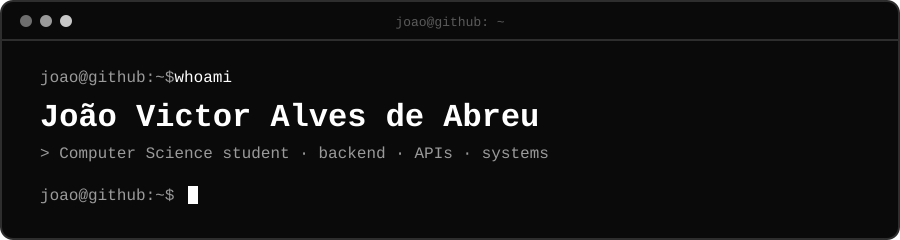
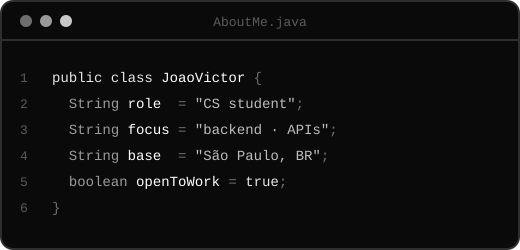

<!-- ============ $ ./profile.sh ============ -->
<p align="center">
  
</p>

<p align="center">
  <a href="https://www.linkedin.com/in/jo%C3%A3ovictoraabreu/"></a>
  <a href="mailto:joaovictoralvesabreu0812@gmail.com"></a>
  <a href="https://github.com/JoaoVictorAAbreu-Dev?tab=repositories"></a>
  
  
</p>

<br/>

<!-- ============ 01. about_me() ============ -->




[](https://git.io/typing-svg)

<div align="justify">

I'm a **Computer Science student** focused on **backend engineering**: building the logic, APIs and data flows that make applications actually work. My day-to-day stack is `Java` and `Spring Boot`, with `TypeScript` / `NestJS`, `Python` and `PostgreSQL` around it.

I like systems that are clear, secure and easy to maintain, from REST APIs and authentication to event-driven processing with queues. Lately I've been exploring **NestJS, AWS SNS/SQS, Rust and Flutter**, always trying to understand the problem first and design the system before writing the code.

</div>

```diff
+ Building backends, APIs and event-driven systems
+ Studying system design, databases and testing
+ Open to backend internship / junior opportunities
- Bugs (working on it)
```

<br clear="right"/>
<br/>

<!-- ============ 02. stack() ============ -->


<p align="center">
  
</p>

<p align="center"><sub>also: Kotlin · Go · C# · C++ · Dart</sub></p>

<br/>

<!-- ============ 03. projects() ============ -->


<!-- PROJECTS:START -->
<table align="center">
  <tr>
    <td width="50%" valign="top">
      <a href="https://github.com/JoaoVictorAAbreu-Dev/gameevent-worker"><strong>gameevent-worker</strong></a><br />
      Backend NestJS com SNS, SQS, PostgreSQL e processamento idempotente de eventos de partidas<br />
      <sub><code>TypeScript</code></sub>
    </td>
    <td width="50%" valign="top">
      <a href="https://github.com/JoaoVictorAAbreu-Dev/atlas-operations-api"><strong>atlas-operations-api</strong></a><br />
      REST API for operational monitoring, prioritization, and field-service planning.<br />
      <sub><code>Java</code> · <code>operations</code> · <code>rest-api</code> · <code>spring-boot</code></sub>
    </td>
  </tr>
  <tr>
    <td width="50%" valign="top">
      <a href="https://github.com/JoaoVictorAAbreu-Dev/lobbylive"><strong>lobbylive</strong></a><br />
      Salas multiplayer com NestJS, Socket.IO, JWT, PostgreSQL e Docker. Presença por conta, chat e testes reais.<br />
      <sub><code>TypeScript</code> · <code>docker</code> · <code>jwt</code> · <code>mikro-orm</code></sub>
    </td>
    <td width="50%" valign="top">
      <a href="https://github.com/JoaoVictorAAbreu-Dev/aetheros-rust-project"><strong>aetheros-rust-project</strong></a><br />
      Educational x86_64 operating system in Rust with a Limine/UEFI boot flow, modular kernel, QEMU validation, and contributor-focused documentation.<br />
      <sub><code>Rust</code> · <code>educational</code> · <code>kernel</code> · <code>limine</code></sub>
    </td>
  </tr>
  <tr>
    <td width="50%" valign="top">
      <a href="https://github.com/JoaoVictorAAbreu-Dev/software-engineering-portfolio"><strong>software-engineering-portfolio</strong></a><br />
      Professional portfolio website presenting selected software-engineering projects and technical case studies.<br />
      <sub><code>TypeScript</code> · <code>frontend</code> · <code>portfolio</code> · <code>react</code></sub>
    </td>
    <td width="50%" valign="top">
      <a href="https://github.com/JoaoVictorAAbreu-Dev/green-operations-control-center"><strong>green-operations-control-center</strong></a><br />
      Web platform for roadside vegetation monitoring, service prioritization, and maintenance-team planning.<br />
      <sub><code>Java</code> · <code>operations</code> · <code>postgresql</code> · <code>react</code></sub>
    </td>
  </tr>
</table>

<details>
<summary><sub>all repositories (60)</sub></summary>

- [gs-2026-cpad](https://github.com/JoaoVictorAAbreu-Dev/gs-2026-cpad) — Global Solution FIAP 2026.2 — Cross-Platform Application Development · `Dart`
- [bloom-mobile-app](https://github.com/JoaoVictorAAbreu-Dev/bloom-mobile-app) — Mobile application project focused on a clean, modern product experience. · `Kotlin`
- [FIA-GS2-POO](https://github.com/JoaoVictorAAbreu-Dev/FIA-GS2-POO) — `Java`
- [gs-2026-dsa](https://github.com/JoaoVictorAAbreu-Dev/gs-2026-dsa) — Global Solution FIAP 2026.2 — Data Science and Analytics · `Jupyter Notebook`
- [gs2-smart-city-edge](https://github.com/JoaoVictorAAbreu-Dev/gs2-smart-city-edge) — `C++`
- [gs-2026-app-dev](https://github.com/JoaoVictorAAbreu-Dev/gs-2026-app-dev) — `JavaScript`
- [gs-2026-cnn](https://github.com/JoaoVictorAAbreu-Dev/gs-2026-cnn) — Global Solution FIAP 2026.2: classificação territorial com CNN e EuroSAT · `Jupyter Notebook`
- [attack-shark-r1-ubuntu](https://github.com/JoaoVictorAAbreu-Dev/attack-shark-r1-ubuntu) — Aplicativo GTK4 para configurar o mouse Attack Shark R1 no Ubuntu · `Rust`
- [pomodoro-study-app](https://github.com/JoaoVictorAAbreu-Dev/pomodoro-study-app) — Simple browser application for focused study sessions using the Pomodoro technique. · `HTML`
- [gameevent-worker](https://github.com/JoaoVictorAAbreu-Dev/gameevent-worker) — Backend NestJS com SNS, SQS, PostgreSQL e processamento idempotente de eventos de partidas · `TypeScript`
- [atlas-operations-api](https://github.com/JoaoVictorAAbreu-Dev/atlas-operations-api) — REST API for operational monitoring, prioritization, and field-service planning. · `Java`
- [queueless-queue-management](https://github.com/JoaoVictorAAbreu-Dev/queueless-queue-management) — TypeScript project for managing queues, service flow, and waiting-time organization. · `TypeScript`
- [lobbylive](https://github.com/JoaoVictorAAbreu-Dev/lobbylive) — Salas multiplayer com NestJS, Socket.IO, JWT, PostgreSQL e Docker. Presença por conta, chat e testes reais. · `TypeScript`
- [cp6-warroom-sentinelas-do-commit](https://github.com/JoaoVictorAAbreu-Dev/cp6-warroom-sentinelas-do-commit) — CP6 FIAP - Sentinelas do Commit | ficha de decisoes e preparacao da War Room FiapBank
- [CP-03-Application-Development](https://github.com/JoaoVictorAAbreu-Dev/CP-03-Application-Development) — Checkpoint 3 de Application Development da FIAP — Sistema de Cadastro de Equipamentos Eletrônicos utilizando HTML, Node.js, Express e MongoDB. · `JavaScript`
- [CP06-SmartFactory](https://github.com/JoaoVictorAAbreu-Dev/CP06-SmartFactory) — `Python`
- [house-price-prediction-model](https://github.com/JoaoVictorAAbreu-Dev/house-price-prediction-model) — Machine-learning project for exploring and predicting residential property prices. · `Python`
- [Fiap-sprint04-POO](https://github.com/JoaoVictorAAbreu-Dev/Fiap-sprint04-POO) — `Java`
- [jobhunter-ai](https://github.com/JoaoVictorAAbreu-Dev/jobhunter-ai) — https://joaovictoraabreu-dev.github.io/jobhunter-ai/ · `Python`
- [ritmo-legal](https://github.com/JoaoVictorAAbreu-Dev/ritmo-legal) — Política de privacidade e exclusão de conta do app Ritmo · `HTML`
- [Fiap-sprint04--application-development](https://github.com/JoaoVictorAAbreu-Dev/Fiap-sprint04--application-development) — FIAP Sprint 04 project focused on application development and implementation practices. · `TypeScript`
- [Fiap-cp02-appication-development](https://github.com/JoaoVictorAAbreu-Dev/Fiap-cp02-appication-development) — Checkpoint 02 — Calculadora de IMC em React | FIAP Application Development · `JavaScript`
- [Fiap-cp05-petfiap-bughunt](https://github.com/JoaoVictorAAbreu-Dev/Fiap-cp05-petfiap-bughunt) — Checkpoint 5 — Bug Hunt PetFiap (Programação Orientada a Objetos) · `Java`
- [aetheros-rust-project](https://github.com/JoaoVictorAAbreu-Dev/aetheros-rust-project) — Educational x86_64 operating system in Rust with a Limine/UEFI boot flow, modular kernel, QEMU validation, and contributor-focused documentation. · `Rust`
- [Fiap-sprint-03-Edge-Computing](https://github.com/JoaoVictorAAbreu-Dev/Fiap-sprint-03-Edge-Computing) — PoC acadêmica de Edge Computing para monitoramento distribuído de vegetação com ESP32, ESP-NOW e MQTT. · `C++`
- [fiap-sprint-02motiva-orion-mobile](https://github.com/JoaoVictorAAbreu-Dev/fiap-sprint-02motiva-orion-mobile) — Mobile experience created for the Motiva ORION challenge during FIAP Sprint 02. · `TypeScript`
- [Fiap-sprint03-dsa](https://github.com/JoaoVictorAAbreu-Dev/Fiap-sprint03-dsa) — `Python`
- [software-engineering-portfolio](https://github.com/JoaoVictorAAbreu-Dev/software-engineering-portfolio) — Professional portfolio website presenting selected software-engineering projects and technical case studies. · `TypeScript`
- [Fiap-CP04-edge-computing](https://github.com/JoaoVictorAAbreu-Dev/Fiap-CP04-edge-computing) — Edge Computing project for distributed vegetation monitoring with connected devices and messaging. · `Python`
- [CP04-streamfiap-bughunt-clube-das-winx](https://github.com/JoaoVictorAAbreu-Dev/CP04-streamfiap-bughunt-clube-das-winx) — `Java`
- [green-operations-control-center](https://github.com/JoaoVictorAAbreu-Dev/green-operations-control-center) — Web platform for roadside vegetation monitoring, service prioritization, and maintenance-team planning. · `Java`
- [pulse-desk-api](https://github.com/JoaoVictorAAbreu-Dev/pulse-desk-api) — Backend API for service-desk workflows, requests, and operational support management. · `Java`
- [focus-pilot-api](https://github.com/JoaoVictorAAbreu-Dev/focus-pilot-api) — Backend API for focus, planning, and personal productivity workflows. · `Java`
- [ledger-pulse-api](https://github.com/JoaoVictorAAbreu-Dev/ledger-pulse-api) — Backend API for financial records, transaction tracking, and personal finance insights. · `Java`
- [taskflow-management-java](https://github.com/JoaoVictorAAbreu-Dev/taskflow-management-java) — Java task-management application focused on organizing work, priorities, and execution flow. · `Java`
- [corporate-ticketing-system-csharp](https://github.com/JoaoVictorAAbreu-Dev/corporate-ticketing-system-csharp) — C# system for registering, organizing, and tracking corporate support requests. · `C#`
- [cpp-mini-database](https://github.com/JoaoVictorAAbreu-Dev/cpp-mini-database) — Educational C++ implementation of a compact database and data-management concepts. · `C++`
- [simplified-digital-banking-java](https://github.com/JoaoVictorAAbreu-Dev/simplified-digital-banking-java) — Educational Java project modeling core flows of a simplified digital-banking application. · `Java`
- [intelligent-inventory-management-java](https://github.com/JoaoVictorAAbreu-Dev/intelligent-inventory-management-java) — Java system for inventory control, stock organization, and management workflows. · `Java`
- [personal-finance-management-java](https://github.com/JoaoVictorAAbreu-Dev/personal-finance-management-java) — Java application for organizing personal finances, transactions, and financial-control routines. · `Java`
- [climate-analytics-platform](https://github.com/JoaoVictorAAbreu-Dev/climate-analytics-platform) — Python project for climate-data analysis and exploratory insights using INMET datasets. · `Python`
- [devtrack-ai-platform](https://github.com/JoaoVictorAAbreu-Dev/devtrack-ai-platform) — AI-oriented developer productivity platform concept for organizing work, learning, and execution. · `Java`
- [focus-loop-lab](https://github.com/JoaoVictorAAbreu-Dev/focus-loop-lab) — TypeScript study lab for focus routines, productivity loops, and iterative product experiments. · `TypeScript`
- [taskflow-ai-groq](https://github.com/JoaoVictorAAbreu-Dev/taskflow-ai-groq) — Task-management project exploring AI-assisted workflows with Groq and Python. · `Python`
- [nba-analysis-bot](https://github.com/JoaoVictorAAbreu-Dev/nba-analysis-bot) — Python bot for NBA-related data exploration, analysis, and automated insights. · `Python`
- [go-programming-studies](https://github.com/JoaoVictorAAbreu-Dev/go-programming-studies) — Study repository for learning Go programming fundamentals and application patterns. · `Go`
- [fiap-campus-platform-gs01](https://github.com/JoaoVictorAAbreu-Dev/fiap-campus-platform-gs01) — FIAP academic platform project developed for CPAD and focused on a campus-oriented digital experience. · `TypeScript`
- [fiap-app-development-gs01](https://github.com/JoaoVictorAAbreu-Dev/fiap-app-development-gs01) — FIAP Global Solution project focused on application-development fundamentals and interface construction. · `CSS`
- [first-python-application](https://github.com/JoaoVictorAAbreu-Dev/first-python-application) — Introductory Python project created to practice the fundamentals of application development.
- [climatemind-ai-study](https://github.com/JoaoVictorAAbreu-Dev/climatemind-ai-study) — JavaScript study project exploring an AI-assisted climate and learning experience. · `JavaScript`
- [jarvis-ai-assistant](https://github.com/JoaoVictorAAbreu-Dev/jarvis-ai-assistant) — Python study project for an AI assistant with voice, automation, and conversational capabilities. · `Python`
- [random-password-generator](https://github.com/JoaoVictorAAbreu-Dev/random-password-generator) — Python study project that generates random passwords with configurable security characteristics. · `Python`
- [deep-learning-fundamentals](https://github.com/JoaoVictorAAbreu-Dev/deep-learning-fundamentals) — Study repository covering foundational concepts and experiments in deep learning. · `Python`
- [fiap-ride-object-oriented-programming](https://github.com/JoaoVictorAAbreu-Dev/fiap-ride-object-oriented-programming) — FIAP academic project applying object-oriented programming concepts to a ride-management domain. · `Java`
- [fiap-object-oriented-programming-cp02](https://github.com/JoaoVictorAAbreu-Dev/fiap-object-oriented-programming-cp02) — FIAP academic exercises and application of object-oriented programming concepts for CP 02. · `Java`
- [fiap-campus-helper-cpad-01](https://github.com/JoaoVictorAAbreu-Dev/fiap-campus-helper-cpad-01) — FIAP academic project for a campus-assistance experience built during CPAD Challenge 01. · `JavaScript`
- [java-study-audio-manager](https://github.com/JoaoVictorAAbreu-Dev/java-study-audio-manager) — Java study project for managing audio resources and practicing application organization. · `Java`
- [java-study-banking-system](https://github.com/JoaoVictorAAbreu-Dev/java-study-banking-system) — Java study project modeling banking operations and object-oriented domain behavior. · `Java`
- [guess-the-number-c](https://github.com/JoaoVictorAAbreu-Dev/guess-the-number-c) — C programming study project implementing a console-based number-guessing game. · `C`
- [secret-number-game](https://github.com/JoaoVictorAAbreu-Dev/secret-number-game) — Browser-based secret-number game created to practice programming and interactive interfaces. · `HTML`

</details>

<p align="center"><sub><a href="https://github.com/JoaoVictorAAbreu-Dev?tab=repositories">$ ls ~/repositories →</a></sub></p>
<!-- PROJECTS:END -->
<br/>

<!-- ============ 04. stats() ============ -->


<p align="center">
  
  
</p>

<p align="center">
  
</p>

<br/>

<!-- ============ 05. contributions() ============ -->


<p align="center">
  
</p>

<!-- ============ exit ============ -->
<p align="center">
  
</p>

<!--
Community projects used:
- https://github.com/DenverCoder1/readme-typing-svg
- https://github.com/anuraghazra/github-readme-stats
- https://github.com/DenverCoder1/github-readme-streak-stats
- https://github.com/Ashutosh00710/github-readme-activity-graph
- https://github.com/tandpfun/skill-icons
-->
