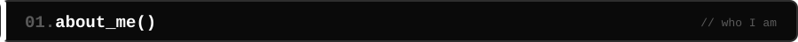
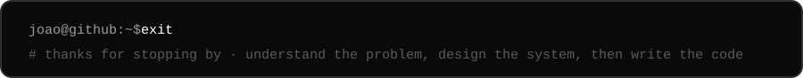

<!-- ============ $ ./profile.sh ============ -->
<p align="center">
  
</p>

<p align="center">
  <a href="https://www.linkedin.com/in/jo%C3%A3ovictoraabreu/"></a>
  <a href="mailto:joaovictoralvesabreu0812@gmail.com"></a>
  <a href="https://github.com/JoaoVictorAAbreu-Dev?tab=repositories"></a>
  
  
</p>

<br/>

<!-- ============ 01. about_me() ============ -->



[](https://git.io/typing-svg)

<div align="justify">

I'm a **Computer Science student** focused on **backend engineering**: building the logic, APIs and data flows that make applications actually work. My day-to-day stack is `Java` and `Spring Boot`, with `TypeScript` / `NestJS`, `Python` and `PostgreSQL` around it.

I like systems that are clear, secure and easy to maintain, from REST APIs and authentication to event-driven processing with queues. Lately I've been exploring **NestJS, AWS SNS/SQS, Rust and Flutter**, always trying to understand the problem first and design the system before writing the code.

</div>

```diff
+ Building backends, APIs and event-driven systems
+ Studying system design, databases and testing
+ Open to backend internship / junior opportunities
- Bugs (working on it)
```

<br clear="right"/>
<br/>

<!-- ============ 02. stack() ============ -->


<p align="center">
  
</p>

<p align="center"><sub>also: Kotlin · Go · C# · C++ · Dart</sub></p>

<br/>

<!-- ============ 03. projects() ============ -->


<!-- PROJECTS:START -->
<table align="center">
  <tr>
    <td width="50%" valign="top">
      <a href="https://github.com/JoaoVictorAAbreu-Dev/lobbylive"><strong>lobbylive</strong></a><br />
      Multiplayer rooms with account-based presence, real-time chat and tested flows.<br />
      <sub><code>NestJS</code> · <code>Socket.IO</code> · <code>JWT</code> · <code>PostgreSQL</code> · <code>Docker</code></sub>
    </td>
    <td width="50%" valign="top">
      <a href="https://github.com/JoaoVictorAAbreu-Dev/gameevent-worker"><strong>gameevent-worker</strong></a><br />
      Backend with SNS, SQS and idempotent processing of match events.<br />
      <sub><code>NestJS</code> · <code>AWS SNS/SQS</code> · <code>PostgreSQL</code></sub>
    </td>
  </tr>
  <tr>
    <td width="50%" valign="top">
      <a href="https://github.com/JoaoVictorAAbreu-Dev/aetheros-rust-project"><strong>aetheros</strong></a><br />
      Educational x86_64 operating system with a modular Rust kernel and UEFI boot.<br />
      <sub><code>Rust</code> · <code>OSDev</code> · <code>QEMU</code></sub>
    </td>
    <td width="50%" valign="top">
      <a href="https://github.com/JoaoVictorAAbreu-Dev/green-operations-control-center"><strong>green-operations-control-center</strong></a><br />
      Platform for roadside vegetation monitoring, prioritization and maintenance planning.<br />
      <sub><code>Java</code> · <code>Spring Boot</code> · <code>React</code> · <code>PostgreSQL</code></sub>
    </td>
  </tr>
  <tr>
    <td width="50%" valign="top">
      <a href="https://github.com/JoaoVictorAAbreu-Dev/atlas-operations-api"><strong>atlas-operations-api</strong></a><br />
      REST API for operational monitoring, prioritization and field-service planning.<br />
      <sub><code>Java</code> · <code>Spring Boot</code> · <code>REST</code></sub>
    </td>
    <td width="50%" valign="top">
      <a href="https://github.com/JoaoVictorAAbreu-Dev/software-engineering-portfolio"><strong>software-engineering-portfolio</strong></a><br />
      Portfolio website with selected projects and technical case studies.<br />
      <sub><code>React</code> · <code>TypeScript</code></sub>
    </td>
  </tr>
</table>

<p align="center"><sub><a href="https://github.com/JoaoVictorAAbreu-Dev?tab=repositories">$ ls ~/repositories →</a></sub></p>

<!-- PROJECTS:END -->
<br/>

<!-- ============ 04. stats() ============ -->


<p align="center">
  
  
</p>

<p align="center">
  
</p>

<br/>

<!-- ============ 05. contributions() ============ -->


<p align="center">
  
</p>

<!-- ============ exit ============ -->
<p align="center">
  
</p>

<!--
Community projects used:
- https://github.com/DenverCoder1/readme-typing-svg
- https://github.com/anuraghazra/github-readme-stats
- https://github.com/DenverCoder1/github-readme-streak-stats
- https://github.com/Ashutosh00710/github-readme-activity-graph
- https://github.com/tandpfun/skill-icons
-->
